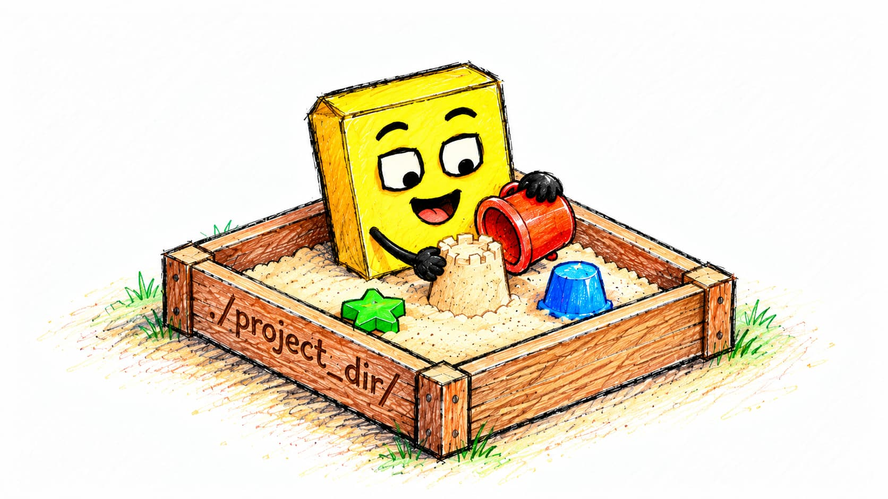

<div align="center">



# nonocode

**Let your agent loose, just not on your whole machine**

</div>

You want your coding agent to get on with the work instead of stopping to ask permission at every step. But approving everything shouldn't mean giving it free rein over your computer.

nonocode uses [nono](https://nono.sh/) to run OpenCode in an OS-level sandbox. You can let OpenCode run commands without asking for approval; the sandbox still restricts where it can write. The agent can still write to your project, temporary files, and OpenCode's own directories. Anywhere else, the operating system blocks the write — enforcement that doesn't rely on a prompt asking the agent to be careful.

It blocks accidental writes outside the allowed directories. It won't stop a deliberate attempt to escape the sandbox, or commands run outside it.

## Install

Runs on Linux/WSL2 (Landlock) and macOS (Seatbelt), x86_64 or ARM64.
**macOS support is experimental and has not been validated on a Mac.**
Run as your regular user, not root.

Install [OpenCode V2](https://opencode.ai/v2/docs/) first. The installer checks
for it and stops if it isn't available; it won't install OpenCode for you.

```sh
curl -fsSL https://raw.githubusercontent.com/Glaicer/supercode-nonocode/main/install.sh | bash
```

The installer sets up nonocode and installs nono if it's missing.
It selects a sandbox profile for your platform, preserving any existing profile.
On macOS, the installer installs missing dependencies through Homebrew; on
Linux/WSL2, it may ask for `sudo`.

### What the installer asks

Three optional extras. Press Enter to accept the defaults:

1. **Let the agent read `~/.ssh/known_hosts` for Git over SSH?** Default: **yes**.
   Without it, `git pull` and `git push` over SSH can fail when the server can't
   be verified. Access is read-only; your SSH keys stay blocked and authentication
   is still separate. Git over HTTPS is not affected.
2. **Use `opencode` for sandboxed project sessions?** Default: **yes**.
   A convenient way to keep using `opencode`: sandboxed inside a project,
   unsandboxed in `~` and `/tmp` for system debugging or general questions.
   Use `opencode --no-sandbox` in any project to run without the sandbox. Choose
   **bash**, **zsh**, or **both**; the default is Zsh if `$SHELL` points to it,
   otherwise Bash. Existing shell files are backed up before changes.
3. **Install the [Sandbox Awareness](https://www.npmjs.com/package/@glaicer/supercode-sandbox-awareness) plugin?** Default: **yes**, recommended.
   Tells the agent about sandbox limits and adds a sandbox indicator to the
   terminal UI. Installed from npm through OpenCode's plugin CLI.

For non-interactive installs, existing local plugins, and exactly what gets
changed, see the [installation details](docs/details.md#installation).

## Usage

The easiest way to use nonocode is to let `install.sh` set up the `opencode`
shell shortcut, enabled by default. Open a new terminal after installation,
then keep using `opencode` as usual:

1. **Inside a project**, `opencode` starts a sandboxed session in that directory.
2. **In `~` or `/tmp`**, it runs without the sandbox, handy for system debugging,
   general questions, or other work outside a project.
3. **Need an unsandboxed session inside a project?** Use `opencode --no-sandbox`.
   Put `--no-sandbox` first, before any other arguments.

Management commands such as `opencode auth login` and `opencode plugin add`
also run without the sandbox.

See the [shell snippet and full routing rules](docs/details.md#shell-integration)
in the technical guide.

## When a tool gets blocked

Tools like Cargo and npm may need to write to caches outside your project.
If the sandbox blocks that access, you can allow the specific path
in `~/.config/nono/opencode-dev.json` rather than running it outside the sandbox
every time.

For example, append the matching entry to the named array in your profile:

| What's blocked | What to add |
| --- | --- |
| npm writing to its cache at `~/.npm` | `"$HOME/.npm"` to `write` |
| Cargo writing to its registry cache at `~/.cargo/registry` | `"$HOME/.cargo/registry"` to `write` |
| SSH reading saved server identities from `~/.ssh/known_hosts` | `"$HOME/.ssh/known_hosts"` to `read_exceptions` |

Example fields only — merge the entries you need into your existing arrays,
without replacing the rest of your profile:

```json
{
  "write": [
    "$HOME/.npm",
    "$HOME/.cargo/registry"
  ],
  "read_exceptions": ["$HOME/.ssh/known_hosts"]
}
```

Use the actual path from the error if yours differs. Edit the profile **outside
the sandbox**, then **restart your sandboxed session**.
These grants apply to every project, so don't allow all of `$HOME` to fix one tool.

See [allowing extra paths](docs/details.md#allowing-extra-paths) for the full
steps, JSON examples, and terminal-device permissions.

## More details

The [technical guide](docs/details.md) covers configuration, shell integration,
sandbox boundaries, the project layout, and verification.
